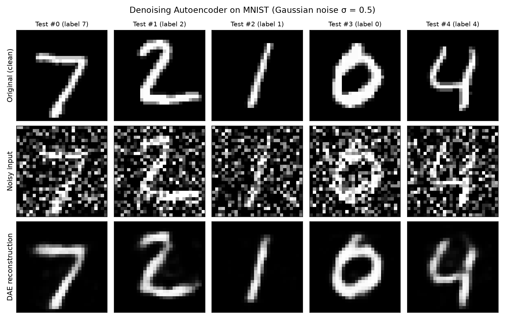
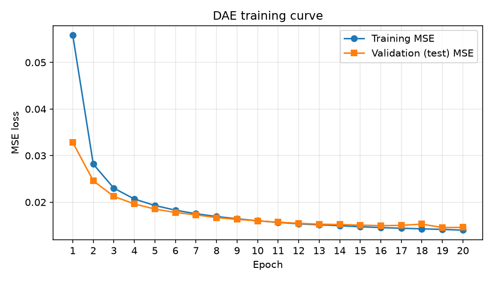
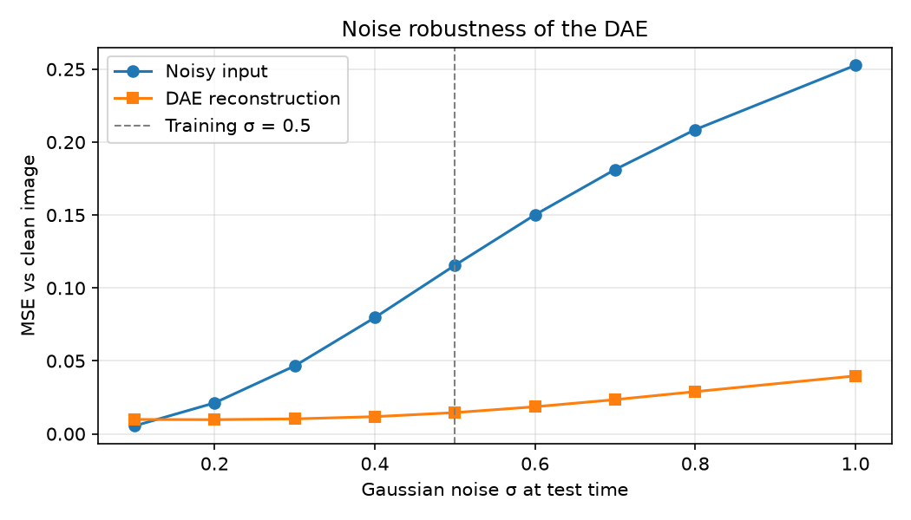
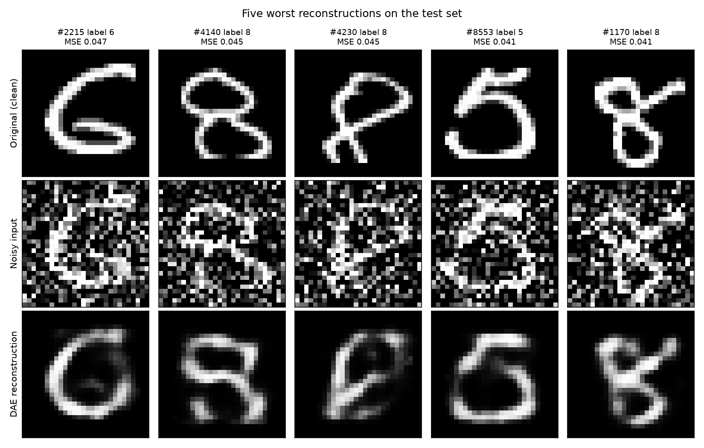
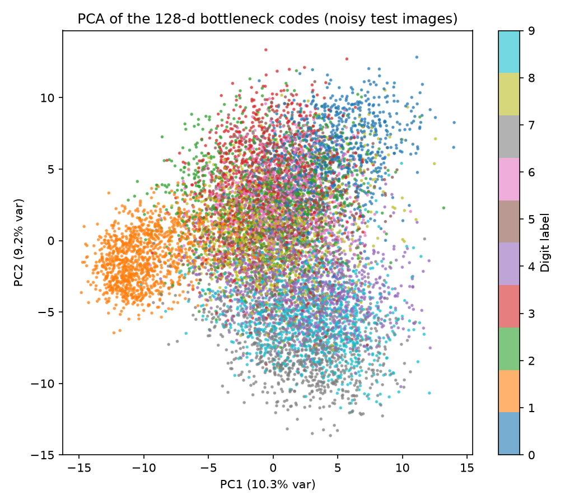

# Denoising Autoencoder (DAE) on MNIST

**Rabail Fatima (23L-2588)**

A multi-layer **Denoising Autoencoder** built with TensorFlow/Keras. It learns to recover clean handwritten digits from MNIST images that have been corrupted with heavy Gaussian noise (σ = 0.5).



## Method

| Step | Details |
|---|---|
| Data | MNIST normalised to [0, 1] and flattened to 784-d vectors |
| Corruption | Additive Gaussian noise, mean 0, **std 0.5**, clamped to [0, 1] |
| Input → Target | Noisy image → clean image |
| Architecture | 784 → Dense 256 (ReLU) → **Dense 128 (ReLU, bottleneck)** → Dense 256 (ReLU) → Dense 784 (Sigmoid) |
| Training | Adam optimiser, MSE loss, 20 epochs, batch size 256 |

## Results (10 000 test images)

| | MSE ↓ | PSNR ↑ |
|---|---|---|
| Noisy input | 0.1159 | 9.37 dB |
| **DAE reconstruction** | **0.0146** | **18.73 dB** |

* **87.4 % lower error** and a **+9.4 dB** PSNR gain. Every test image is improved.
* Final training MSE 0.0140 and validation MSE 0.0146, so the model shows no overfitting.
* It stays robust at noise levels it was not trained on (σ = 0.2 to 1.0).
* The 128-d latent space separates digit classes even though no labels were used in training.

| Training curve | Noise robustness |
|---|---|
|  |  |

| Worst reconstructions | Latent space (PCA) |
|---|---|
|  |  |

The full discussion is in the notebook (section 4.5).

## Files

| File | Description |
|---|---|
| `DAE_MNIST.ipynb` | Main notebook, executed with all outputs |
| `DAE_MNIST.html` | HTML export of the notebook |
| `dae_mnist.keras` | Trained model |
| `*.png` | Result figures |
| `build_notebook.py` | Script that generates the notebook |
| `analysis.md` | Discussion text inserted into the notebook |

## Run it yourself

```bash
python -m venv .venv
# Windows: .venv\Scripts\activate   |   Linux/macOS: source .venv/bin/activate
pip install tensorflow matplotlib numpy jupyter
jupyter notebook DAE_MNIST.ipynb
```

To load the trained model:

```python
from tensorflow import keras
dae = keras.models.load_model("dae_mnist.keras")
```
